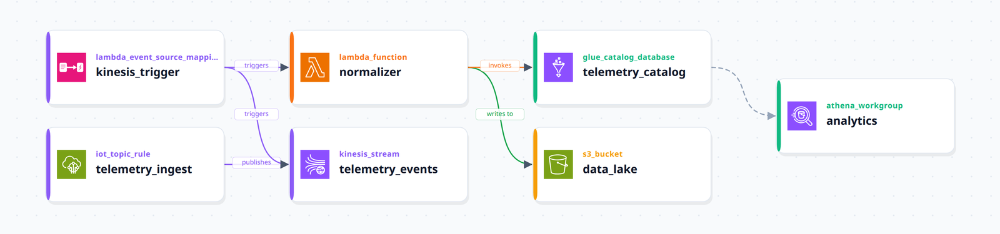
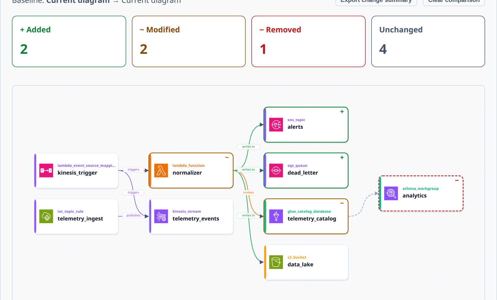

# IaC Board

**Turn Terraform into an interactive AWS architecture diagram, right in your browser.**

[](https://github.com/AndresGuido9820/iac-board/actions/workflows/ci.yml)
[](LICENSE)

**[Live demo →](https://andresguido9820.github.io/iac-board/)** · [Examples](examples/terraform) · [Architecture](docs/engineering/architecture.md) · [Contributing](docs/contributing.md)



IaC Board reads `.tf` files as text, builds a graph of your cloud resources and how they connect, lays it out automatically and renders an interactive SVG diagram. It never runs `terraform` and never calls a cloud API, so there are no credentials to configure and nothing leaves your browser.

---

## Features

- **Zero-execution parsing.** Reads `.tf` and `.tfvars` as text; never calls `terraform` or any cloud API.
- **Plan JSON mode.** Import `terraform show -json` output for exact dependency edges instead of inferred ones.
- **Interactive canvas.** Pan, zoom, drag nodes, keyboard navigation, minimap.
- **Node inspector.** Click a resource to see its type, category, source line and connections.
- **Groups and labels.** VPCs and subnets render as containers; edges carry relation labels (triggers, invokes, writes to, uses role, …).
- **Architecture comparison.** Pin a baseline, import a new revision and see added, modified and removed resources on one combined diagram. Export a value-free JSON summary.
- **Export.** SVG (lossless) and PNG (2×).
- **Saved layouts.** Node positions persist in `.iac-board.json` and can be loaded back.
- **Parser diagnostics.** Unsupported resources are reported with file and line.
- **Five bundled examples.** Serverless API, IoT pipeline, VPC + RDS, ECS microservices and a modular app with local modules.
- **English and Spanish UI.**



---

## Quick start

Try it without installing anything: **[andresguido9820.github.io/iac-board](https://andresguido9820.github.io/iac-board/)**.

Run it locally (Node.js 22 or newer; CI uses Node 24):

```bash
git clone https://github.com/AndresGuido9820/iac-board.git
cd iac-board
npm install
npm run dev
```

Open <http://localhost:5173>, then drop `.tf` files on the import zone or pick one of the bundled examples.

### Exact edges from a Terraform plan

```bash
terraform init
terraform plan -out=tfplan
terraform show -json tfplan > plan.json
```

Drop `plan.json` on the import zone. Edges then come from `configuration.root_module` references and are marked `confidence: exact`.

### Compare two revisions

1. Load the previous `.tf` files and choose **Use current as baseline**, or choose **Load baseline files** to pick previous `.tf` files or one plan JSON.
2. Import the updated version in the main import zone. The baseline stays fixed while the current diagram changes.
3. Review the **+ Added**, **~ Modified** and **− Removed** cards and node markers. Removed nodes keep their old connections in the combined diagram.
4. Select a resource to inspect its before/after configuration and connections, or choose **Export change summary** to download `architecture-diff.json` (no attribute values).

**Try comparison demo** loads a complete example without any files.

<details>
<summary>What the comparison does and does not do</summary>

Comparison is based on parsed resource configuration, connections and group membership. It ignores comments, source locations, attribute order and object-key order; list and repeated-block order remain significant. It does not execute Terraform or predict create/update/replace actions. Plan inputs compare known `planned_values`; unknown values are not evaluated. Comparing HCL against plan JSON uses different representations and may report configuration changes even when they describe the same infrastructure, so use matching input formats.

Parser coverage limits apply: `.tfvars`, remote modules, unresolved expressions and dependencies outside the imported files are not fully evaluated. A renamed resource appears as removed plus added. Baselines live in memory for the current session.

</details>

---

## How it works

Each stage is an independent workspace package with its own tests:

```text
.tf files / plan.json
   │  @iac-board/terraform-parser   HCL lexer + parser, plan JSON reader
   ▼
resources + diagnostics
   │  @iac-board/cloud-graph        resource → node, reference → typed edge, VPC/subnet groups
   ▼
cloud graph
   │  @iac-board/layout-engine      Sugiyama-style layering, crossing reduction, group-aware placement
   ▼
positioned graph
   │  @iac-board/canvas-engine      positions → canvas element drafts
   ▼
   │  @iac-board/visual-engine      React SVG renderer (CloudBoard)
   ▼
interactive diagram
```

Design notes: [`docs/engineering/architecture.md`](docs/engineering/architecture.md) and the decision records in [`docs/adr/`](docs/adr/).

---

## Supported AWS resources

| Category    | Resource types                                                                                                                                                                                                                      |
| ----------- | ----------------------------------------------------------------------------------------------------------------------------------------------------------------------------------------------------------------------------------- |
| Compute     | `aws_lambda_function`, `aws_ecs_cluster`, `aws_ecs_service`, `aws_ecs_task_definition`, `aws_eks_cluster`, `aws_autoscaling_group`, `aws_instance`                                                                                  |
| Network     | `aws_vpc`, `aws_subnet`, `aws_internet_gateway`, `aws_nat_gateway`, `aws_lb`, `aws_alb`, `aws_cloudfront_distribution`, `aws_route53_zone`, `aws_db_subnet_group`                                                                   |
| Storage     | `aws_s3_bucket`, `aws_s3_object`                                                                                                                                                                                                    |
| Database    | `aws_db_instance`, `aws_rds_cluster`, `aws_dynamodb_table`, `aws_elasticache_cluster`, `aws_elasticache_replication_group`, `aws_redshift_cluster`, `aws_athena_workgroup`, `aws_glue_catalog_database`                             |
| Integration | `aws_api_gateway_rest_api`, `aws_apigatewayv2_api`, `aws_sqs_queue`, `aws_sns_topic`, `aws_kinesis_stream`, `aws_kinesis_firehose_delivery_stream`, `aws_eventbridge_rule`, `aws_lambda_event_source_mapping`, `aws_iot_topic_rule` |
| Security    | `aws_iam_role`, `aws_iam_policy`, `aws_security_group`, `aws_cognito_user_pool`, `aws_secretsmanager_secret`, `aws_kms_key`                                                                                                         |
| ML          | `aws_sagemaker_endpoint`, `aws_sagemaker_model`                                                                                                                                                                                     |

Other resource types still render, with an `unknown` category and a parser diagnostic.

---

## Accessibility

- The diagram is keyboard operable: focus it and use the arrow keys to move between resources; the inspector follows the selection.
- `Escape` closes the node inspector.
- Controls are native buttons and links with accessible names; the UI is available in English and Spanish.

---

## Development

```bash
npm test               # unit + integration tests (Vitest)
npm run test:e2e       # end-to-end tests (Playwright, builds and serves the app)
npm run test:visual    # visual regression snapshots
npm run check:ci       # format, lint, typecheck, tests with coverage, build
```

Project layout:

```text
apps/web/            React + Vite application
packages/            parser, graph, layout, canvas and visual engines, pipeline, example catalog
examples/terraform/  raw .tf files for the bundled examples
tests/               end-to-end and visual regression tests
docs/                architecture, ADRs, testing strategy, git workflow
```

---

## Contributing

Issues and pull requests are welcome. Read [docs/contributing.md](docs/contributing.md) and [docs/git-workflow.md](docs/git-workflow.md) first. In short: branch from `main`, add tests with your change, run `npm run check:ci`, and open a PR with a summary and test plan.

## License

[MIT](LICENSE) © 2026 Andres Guido
